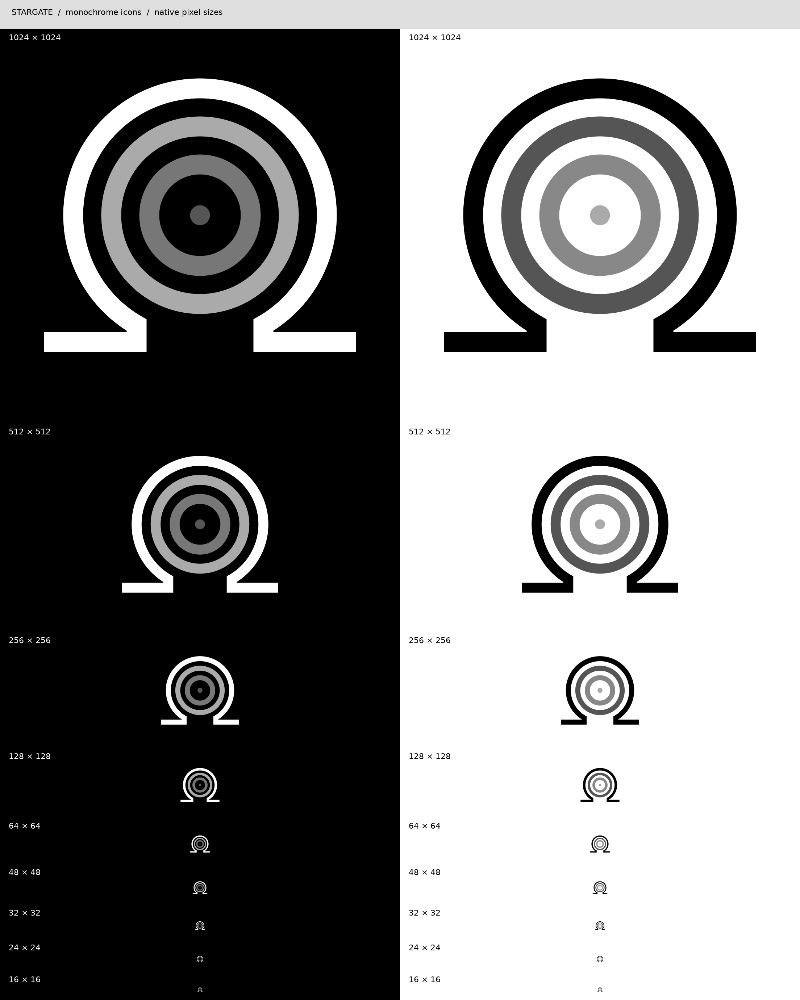

# Stargate icons

Original Stargate artwork from the supplied `stargate-icons.zip` archive.
PNG files are unchanged. The SVG files have a final newline added to meet
repository file-hygiene rules; their artwork is unchanged.

- **Dark:** [SVG](stargate-dark.svg).
- **Light:** [SVG](stargate-light.svg).

The names describe the ink: `dark` is dark artwork on white for a light
surface; `light` is light artwork on black for a dark surface. Both variants
have opaque backgrounds. Keep the originals unchanged when using the mark.

PNG sizes: 16, 24, 32, 48, 64, 128, 256, 512 and 1024 px.

PNG filenames use `stargate-{dark,light}-{size}.png`.

## In Stargate

The repository README selects the SVG for the reader's light or dark theme.
The dashboard embeds the original 64 px PNGs at 32 CSS pixels, alongside the
Stargate name, and uses the original 32 px PNGs as its themed favicons. These
images require no public asset hostname, external request or extra HTTP route.

## Chat app icons

For a Slack app, open **Basic Information → Display Information** in that app's
settings and select `stargate-dark-1024.png` from this directory as its icon.
Preview it before saving. This is a separate app setting: the generated Slack
manifest does not install an icon, and changing this repository does not update
an existing Slack app. Use a persona-specific icon instead when that app has
its own identity.

Teams package assembly belongs to the deployment that registers the bot.
Stargate supplies the transport, not a generated Teams app package. These
opaque PNGs are not transparent outline icons; do not rename a 32 px original
to `outline.png` and treat it as one. Prepare and validate the package's icon
variants in its owning deployment. The same boundary applies to Azure Bot and
GitHub App display settings: no external app branding is changed here.

## GitHub social preview

[PNG](stargate-social-preview.png) · [SVG source](stargate-social-preview.svg)

The 1280 × 640 preview places the unchanged dark SVG beside the Stargate name
and its supported chat transports. The PNG is an offline browser rendering of
that self-contained SVG. It loads no external artwork or fonts. A repository
owner can review the PNG and upload it through the repository's social-preview
setting; committing this file does not upload it or change that setting.

## Contact sheet

